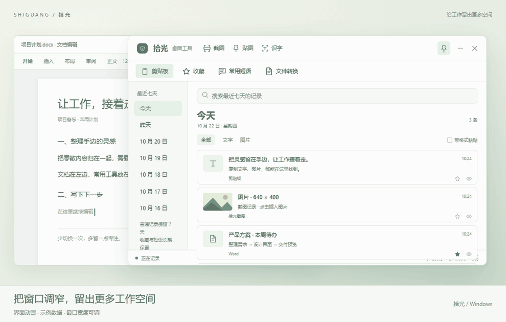

<h1 align="center">拾光 · Shiguang</h1>

把顺手的小事，留在手边。

Windows 桌面工具 · Tauri + Rust + Vue · AGPL-3.0

拾光把剪贴板管理、截图贴图、文字识别和离线 Word/PDF 转换放在一个简洁的小窗口里。复制过的内容随时找回，常用内容一键插入，让工作接着走。

当前为 Windows x64 预览版。macOS 属于后续计划，尚未提供安装包。

## 下载

- **[下载 Windows 安装包 v0.1.2](https://github.com/p516757794/shiguang/raw/refs/heads/main/downloads/shiguang-0.1.2-x64-setup.exe)**
- [更新记录](CHANGELOG.md) · [开发与贡献](CONTRIBUTING.md) · [第三方说明](THIRD_PARTY_NOTICES.md)

## 15 秒预览

拖动边缘，将工具横向收至最小宽度 **340 px**，放在文档窗口旁；记录保持单列，点击插入、滚动查看。

15 秒循环播放，直接在主页观看。以上为示例数据制作的界面动画，并非实际桌面录屏。

## 可以做什么

| 功能 | 使用方式 |
| --- | --- |
| 剪贴板历史 | 文字与图片自动记录，默认保留七天，按日查看、搜索、重复合并、拖动排序及删除 |
| 收藏与常用短语 | 收藏图标填充显示，常用内容长期保存，点一下插入原编辑位置 |
| 内容预览与编辑 | 点击右下角预览；支持格式切换、编辑后保存，点击弹窗外关闭 |
| 带格式粘贴 | 默认关闭；勾选后保留已记录的 HTML / RTF 等格式，具体效果取决于目标软件支持及粘贴策略 |
| 截图 | 顶部框选入口，框选完成默认复制 |
| 贴图 | 停留在框选位置，默认原尺寸、置顶、不自动复制；支持拖动、边缘缩放、透明度和悬停折叠 |
| 框选识字 | 使用 Windows 中文 / 英文 OCR，按识别原行展示；手动点击才复制 |
| Word ⇄ PDF | 按需下载本地组件，批量拖入、后台处理、暂停继续、取消和失败重试，结果保存至来源文件夹 |
| 桌面习惯 | 图钉按需置顶、可调整窗口尺寸、全局快捷键、记录保留规则及托盘退出 |

## 安装与首次使用

1. 下载 Windows x64 安装包，安装完成页可勾选创建桌面快捷方式。升级前先从托盘退出旧版。
2. 普通使用者不需要安装 Rust、Node.js 或 C++ 工具；电脑缺少 WebView2 时，安装流程会联网下载微软运行时。
3. 复制文字或图片后，在拾光窗口中查看。先在 Word 等目标软件放好光标，再点击记录插入。
4. 使用文件转换时，打开“设置 → 常规 → 离线转换组件”，点击“自动下载组件”。首次约 303 MiB，建议预留 2 GB 空间；之后本地转换不需要联网。
5. 点击窗口关闭按钮会收起到托盘；使用托盘菜单或设置内“退出拾光”才真正退出。

## 文件转换说明

- Word → PDF 使用 LibreOffice 便携组件，PDF → Word 使用 pdf2docx。
- 支持批量 .doc、.docx 和 .pdf；结果写入原文件夹，重名自动编号，保留源文件。
- 暂停会停止当前文件；继续时从该文件开头重新转换，已完成文件保留。
- 已转换记录可以逐条或全选删除，删除记录不会删除生成文件。
- 首次组件下载需要网络，完整且校验通过的缓存会在重试时复用。7-Zip 主地址失败会切换固定备用地址，包括第三方 gh-proxy.com，所有来源均核对同一份大小和 SHA-256。
- 复杂表格、字体、扫描 PDF 及加密文件可能无法完整还原；PDF 转 Word 尚未接入扫描件 OCR。

## 数据与隐私

剪贴板记录、截图和转换任务在本机保存。文件转换在本机运行，不上传用户文档。安装时下载 WebView2、首次下载转换组件时需要网络。文字识别需要电脑具备对应的 Windows OCR 语言组件。

## 当前状态

这是持续完善中的预览版本，公开源码方便大家查看、修改和反馈。安装包已进行构建与包内容核对，尚未完成所有功能及不同 Windows / 多屏 DPI 环境的实机验收。当前安装包未签名。

## 开源协议

拾光源码按 **AGPL-3.0-only** 提供，见 [LICENSE](LICENSE)。欢迎在协议约定下使用、修改及贡献。第三方依赖和可选转换组件遵循各自的许可，详见 [第三方说明](THIRD_PARTY_NOTICES.md) 及 [转换组件说明](components/COMPONENT-NOTICES.md)。

## 参与完善

发现问题请提交 [Issue](https://github.com/p516757794/shiguang/issues)，说明版本、Windows 版本、重现步骤和预期行为。请先去除截图或日志中的私人剪贴板内容。代码修改建议先说明问题与范围，再提交 Pull Request。
